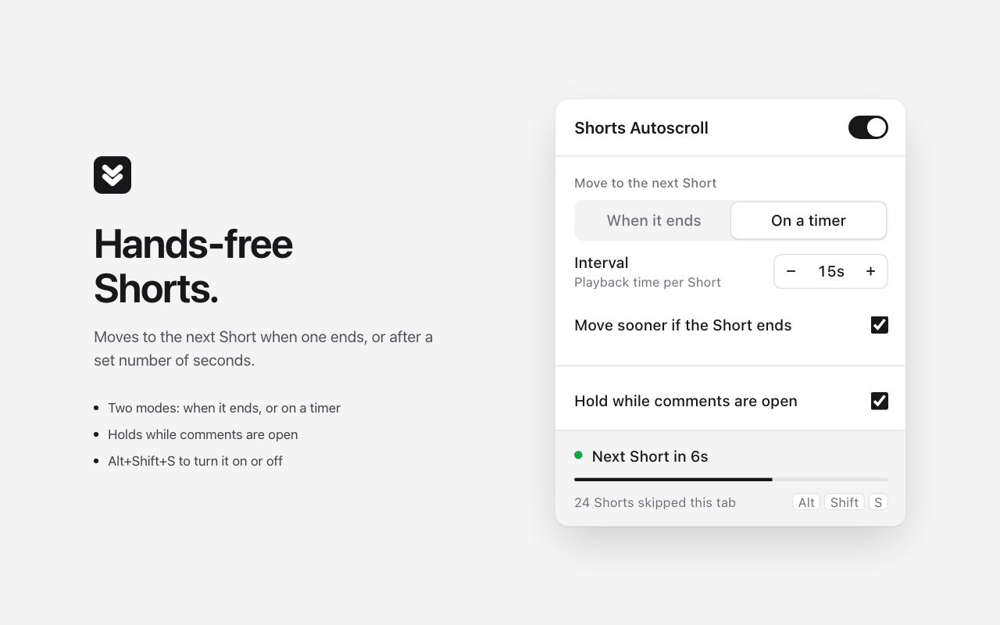

# Shorts Autoscroll

A Chrome extension that moves to the next YouTube Short for you, so you don't have to scroll every time a clip ends.

<p align="center"></p>

## Features

- **When it ends:** moves on after a Short finishes. It can play each one 1 to 5 times first.
- **On a timer:** moves on after 3 to 120 seconds of playback. You can also have it move on early when the Short ends first.
- **Holds when it should:** while the comments or description panel is open, while the video is paused, or while the tab is in the background (so you don't skip Shorts you never saw).
- **Live status** in the popup: time left, a progress bar and how many Shorts it has skipped.
- **Shortcut:** <kbd>Alt</kbd> + <kbd>Shift</kbd> + <kbd>S</kbd> turns it on or off. You can change it at `chrome://extensions/shortcuts`.

## Install from source

1. Clone this repository.
2. Open `chrome://extensions` and turn on **Developer mode**.
3. Click **Load unpacked** and select the `extension/` folder.
4. Open any `youtube.com/shorts/…` page.

## Project layout

```
extension/        The extension itself (this is what gets published)
  manifest.json
  content.js      Watches the Shorts player and moves to the next clip
  background.js   Toolbar badge and keyboard shortcut
  popup.*         Settings popup
  settings.js     Default settings shared by all scripts
store/            Chrome Web Store listing text, images and permission notes
scripts/          Packaging
PRIVACY.md        Privacy policy
```

## How it works

YouTube plays Shorts on a loop and turns looping back on if anything removes it, so the video's `ended` event almost never fires. Instead, the content script treats the playback time jumping from the end back to the start as one finished play. To go to the next clip it clicks the player's own **Next** button, and if that button is missing it sends an <kbd>↓</kbd> key press.

The timer counts only time the video is actually playing, so buffering, pausing and background tabs don't use it up.

## Packaging for the Chrome Web Store

```bash
./scripts/package.sh
```

This creates `dist/shorts-autoscroll-<version>.zip` from `extension/`, ready to upload in the [Chrome Web Store Developer Dashboard](https://chrome.google.com/webstore/devconsole). The listing text, permission justifications and images are in [`store/`](store/).

To release an update, raise `version` in `extension/manifest.json` and run the script again.

## Privacy

The extension collects no data and makes no network requests. Settings are stored with Chrome sync storage. See [PRIVACY.md](PRIVACY.md).

## License

[MIT](LICENSE)

_Not affiliated with or endorsed by YouTube or Google._
